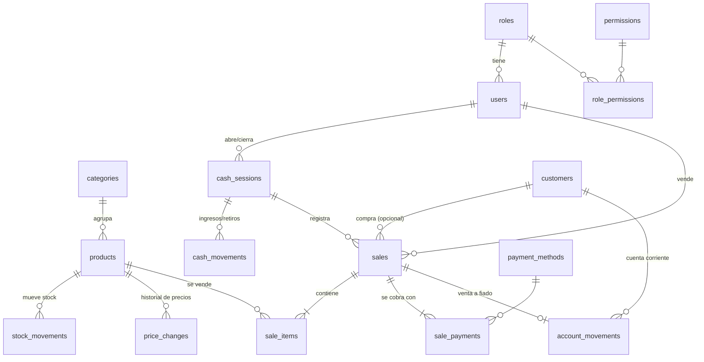

# Benqui Go API – Diseño de tablas (borrador v1)

Sistema de punto de venta para negocios chicos: kioscos, drugstores, farmacias, almacenes.
Stack: NestJS + Prisma + PostgreSQL (mismas convenciones que `fireextracking-api`).

Objetivo: **lo justo para trabajar tranquilo**: vender rápido (código de barras, código corto o foto), controlar la caja, el stock y el fiado, y actualizar precios en masa.

## 1. Convenciones

- Tablas en `snake_case` plural (`@@map`), modelos Prisma en `PascalCase` singular.
- PK `id` UUID (`@default(uuid())`).
- **Auditoría en todas las tablas**: `created_by`, `updated_by`, `deleted_by` (UUID de `users`), `is_deleted` (soft delete), `deleted_at`, `created_at`, `updated_at` (`Timestamptz`). Abajo se omiten.
- Auth: login con `user_name` + `password` (argon2), JWT + refresh token (hash), roles y permisos por módulo. Bloqueo tras 5 intentos fallidos (15 min).
- Dinero: `Decimal(12,2)`. **Cantidades y stock: `Decimal(12,3)`** (permite vender por kilo: 0,250 kg).
- La API devuelve los `Decimal` como string (`"1500.00"`, `"0.250"`).
- Moneda: pesos argentinos. Zona horaria: `America/Argentina/Salta`.
- Paginación: `page`, `limit` (1..100, default 20), `search` → `{ data, total, page, limit }`.

## 2. Diagrama de relaciones



## 3. Seguridad

Igual que fireextracking: `roles`, `permissions`, `role_permissions`, `users`.

| Rol | Puede |
|---|---|
| **Administrador** | Todo: productos y precios, usuarios, configuración, anular ventas, ajustar stock, ver costos y ganancias |
| **Cajero** | Vender, abrir/cerrar su caja, ingresos/retiros, clientes y cobros de fiado, consultar productos y stock |

Permisos sugeridos: `sales.create`, `sales.void`, `products.read`, `products.write`, `prices.update`, `stock.adjust`, `cash.operate`, `customers.write`, `reports.read`, `settings.update`, `users.write`.

## 4. Configuración

### `business_settings` (una sola fila)
| Campo | Tipo | Notas |
|---|---|---|
| name | varchar(120) | Nombre del negocio (sale en el ticket) |
| business_type | enum | `KIOSK`, `DRUGSTORE`, `PHARMACY`, `GROCERY`, `OTHER` (sugiere categorías iniciales) |
| cuit | varchar(11) null | |
| address | varchar(255) null | |
| phone | varchar(30) null | |
| logo_url | varchar(500) null | |
| ticket_footer | varchar(255) null | "¡Gracias por su compra!" |
| ticket_width | int default 80 | 58 u 80 mm |
| print_ticket | enum default `ASK` | `ALWAYS`, `ASK`, `NEVER` |
| allow_negative_stock | bool default true | En un kiosco no se frena una venta por stock mal cargado |
| require_cash_session | bool default true | Exige caja abierta para vender |
| next_sale_number | int default 1 | |

### `payment_methods` (medios de pago)
| Campo | Tipo | Notas |
|---|---|---|
| name | varchar(60) | "Efectivo", "Débito", "Crédito", "Transferencia", "QR / Mercado Pago", "Fiado" |
| kind | enum | `CASH`, `DEBIT`, `CREDIT`, `TRANSFER`, `QR`, `ACCOUNT` (fiado) |
| surcharge_percent | decimal(5,2) default 0 | Recargo opcional (ej. crédito 10%) |
| order | int null | |
| is_active | bool default true | |

Semilla: los 6 de arriba. Solo `CASH` calcula vuelto y suma al efectivo esperado de la caja. `ACCOUNT` exige un cliente.

## 5. Catálogo

### `categories`
| Campo | Tipo | Notas |
|---|---|---|
| name | varchar(80) | Único entre activas |
| color | varchar(7) | `#f59e0b`: pestaña de la venta y fondo de los productos sin foto |
| icon | varchar(16) null | Emoji (🥤 🍫 🚬 🥛 🧴 💊…): identifica la categoría y a sus productos sin foto |
| order | int null | |
| is_active | bool default true | |

Semilla según `business_type`. Kiosco: Bebidas, Golosinas, Galletitas y snacks, Cigarrillos, Almacén, Lácteos, Helados, Perfumería y limpieza, Varios.

### `products`
| Campo | Tipo | Notas |
|---|---|---|
| barcode | varchar(32) null | EAN-13/EAN-8/UPC. Único entre activos (lo valida la API → 409) |
| code | varchar(10) null | **Código corto** para tipear rápido (`12`, `ALF`). Único entre activos |
| name | varchar(150) | "Coca-Cola 500 ml" |
| category_id | uuid FK categories null | |
| image_url | varchar(500) null | Foto (Vercel Blob). Sin foto: color de categoría + iniciales |
| sale_unit | enum default `UNIT` | `UNIT` o `KG`. En `KG` el precio es por kilo y la cantidad admite decimales |
| cost_price | decimal(12,2) null | Costo (solo lo ve el admin) |
| sale_price | decimal(12,2) | Precio de venta (por unidad o por kilo) |
| track_stock | bool default true | `false` para recargas, fotocopias, servicios |
| stock | decimal(12,3) default 0 | Lo mantiene la API con `stock_movements` (no se edita directo) |
| min_stock | decimal(12,3) null | Alerta de stock bajo |
| is_favorite | bool default false | Aparece en "Favoritos", la primera pestaña de la venta |
| is_active | bool default true | |
| notes | varchar(500) null | |

Índices: `barcode`, `code`, `name`, `category_id`.
Calculados (no se guardan): `margin_percent = (sale - cost) / cost`, `low_stock = track_stock && stock <= min_stock`.

### `price_changes` (historial de precios)
| Campo | Tipo | Notas |
|---|---|---|
| product_id | uuid FK products | |
| old_sale_price | decimal(12,2) | |
| new_sale_price | decimal(12,2) | |
| old_cost_price | decimal(12,2) null | |
| new_cost_price | decimal(12,2) null | |
| reason | enum | `MANUAL`, `BULK`, `IMPORT` |
| batch_id | uuid null | Agrupa una actualización masiva (permite ver "+12% a Bebidas el 14/11") |

**Actualización masiva**: `POST /products/bulk-price` con `{ percent, categoryId?, productIds?, applyTo: 'SALE' | 'COST' | 'BOTH', rounding: 'NONE' | 'TEN' | 'FIFTY' | 'HUNDRED' }`. El redondeo es clave en kioscos ($1.537 → $1.540).

## 6. Stock

### `stock_movements`
| Campo | Tipo | Notas |
|---|---|---|
| product_id | uuid FK products | |
| type | enum | `PURCHASE` (ingreso de mercadería), `SALE`, `SALE_VOID` (anulación), `ADJUSTMENT` (conteo), `LOSS` (rotura/vencido) |
| quantity | decimal(12,3) | Con signo: + entra, − sale |
| stock_after | decimal(12,3) | Stock resultante |
| unit_cost | decimal(12,2) null | En `PURCHASE`: si cambia, actualiza `cost_price` (con `price_changes`) |
| sale_id | uuid FK sales null | |
| notes | varchar(255) null | "Proveedor Arcor", "Se rompió" |

`POST /stock/purchases` admite varios renglones (`items[]`) para cargar una compra completa escaneando.

## 7. Caja

### `cash_sessions` (turnos de caja)
| Campo | Tipo | Notas |
|---|---|---|
| opened_by | uuid FK users | |
| opened_at | timestamptz | |
| opening_amount | decimal(12,2) | Cambio inicial |
| closed_by | uuid FK users null | |
| closed_at | timestamptz null | |
| expected_cash | decimal(12,2) null | Calculado al cerrar: inicial + ventas en efectivo + cobros de fiado en efectivo + ingresos − retiros − vueltos |
| counted_cash | decimal(12,2) null | Lo que contó el cajero |
| difference | decimal(12,2) null | counted − expected (sobrante/faltante) |
| status | enum | `OPEN`, `CLOSED` |
| notes | varchar(500) null | |

Una sola caja abierta a la vez (un mostrador). El cierre devuelve el resumen por medio de pago para imprimir.

### `cash_movements`
| Campo | Tipo | Notas |
|---|---|---|
| cash_session_id | uuid FK cash_sessions | |
| type | enum | `INCOME` (ingreso), `EXPENSE` (pago a proveedor, gasto), `WITHDRAWAL` (retiro del dueño) |
| amount | decimal(12,2) | Siempre positivo |
| reason | varchar(255) | |

## 8. Clientes y fiado

### `customers`
| Campo | Tipo | Notas |
|---|---|---|
| name | varchar(150) | Nombre como lo conoce el negocio ("Marta del 3°B") |
| phone | varchar(30) null | |
| document | varchar(11) null | DNI/CUIT |
| address | varchar(255) null | |
| credit_limit | decimal(12,2) null | Tope de fiado (null = sin tope). Si lo supera la API responde 400, salvo que el admin lo autorice (`force: true`) |
| balance | decimal(12,2) default 0 | **Deuda actual** (lo mantiene la API con `account_movements`) |
| notes | varchar(500) null | |

### `account_movements` (cuenta corriente)
| Campo | Tipo | Notas |
|---|---|---|
| customer_id | uuid FK customers | |
| type | enum | `CHARGE` (venta fiada), `PAYMENT` (pago del cliente), `ADJUSTMENT` |
| amount | decimal(12,2) | Con signo: + aumenta la deuda, − la reduce |
| balance_after | decimal(12,2) | |
| sale_id | uuid FK sales null | |
| payment_method_id | uuid FK payment_methods null | Con qué pagó (en `PAYMENT`) |
| cash_session_id | uuid FK cash_sessions null | Para que el cobro en efectivo entre en la caja |
| notes | varchar(255) null | |

## 9. Ventas

### `sales`
| Campo | Tipo | Notas |
|---|---|---|
| number | int unique | Correlativo (`next_sale_number`) |
| cash_session_id | uuid FK cash_sessions null | |
| user_id | uuid FK users | Cajero |
| customer_id | uuid FK customers null | Obligatorio si algún pago es `ACCOUNT` |
| subtotal | decimal(12,2) | Suma de ítems |
| discount_amount | decimal(12,2) default 0 | Descuento general |
| surcharge_amount | decimal(12,2) default 0 | Recargos por medio de pago |
| total | decimal(12,2) | subtotal − descuento + recargo |
| status | enum | `COMPLETED`, `VOIDED` |
| voided_at / voided_by / void_reason | | Anulación (solo admin): devuelve stock y revierte el fiado |
| notes | varchar(255) null | |

### `sale_items`
| Campo | Tipo | Notas |
|---|---|---|
| sale_id | uuid FK sales | |
| product_id | uuid FK products null | **null = "Varios"** (producto no cargado, se tipea el precio) |
| description | varchar(150) | Copia del nombre (no cambia si se renombra el producto) |
| quantity | decimal(12,3) | Unidades o kilos |
| unit_price | decimal(12,2) | Copia del precio (editable si tiene permiso) |
| unit_cost | decimal(12,2) null | Copia del costo, para el reporte de ganancia |
| discount_amount | decimal(12,2) default 0 | |
| subtotal | decimal(12,2) | quantity × unit_price − descuento (redondeado a 2 decimales) |

### `sale_payments`
| Campo | Tipo | Notas |
|---|---|---|
| sale_id | uuid FK sales | |
| payment_method_id | uuid FK payment_methods | |
| amount | decimal(12,2) | Lo que se imputa a la venta |
| surcharge_amount | decimal(12,2) default 0 | |
| received_amount | decimal(12,2) null | Solo efectivo: con cuánto pagó |
| change_amount | decimal(12,2) null | Vuelto |

Permite **pago combinado** (parte efectivo, parte débito). La suma de `amount` debe ser igual al `total`.

### Flujo `POST /sales`
```json
{
  "customerId": null,
  "discountAmount": 0,
  "items": [
    { "productId": "…", "quantity": 2 },
    { "productId": "…", "quantity": 0.25 },
    { "description": "Varios", "quantity": 1, "unitPrice": 500 }
  ],
  "payments": [
    { "paymentMethodId": "…efectivo", "amount": 3000, "receivedAmount": 5000 }
  ]
}
```
En una transacción: valida caja abierta, toma número, copia precios y costos, descuenta stock (`SALE`), registra pagos, y si hay `ACCOUNT` genera el `CHARGE` en la cuenta del cliente. Devuelve la venta completa para imprimir el ticket.

## 10. Reportes (consultas, sin tablas)

- `GET /reports/daily?date=` – total vendido, cantidad de ventas, ticket promedio, por medio de pago, por categoría, ganancia estimada (admin).
- `GET /reports/top-products?from=&to=` – más vendidos (cantidad e importe).
- `GET /reports/low-stock` – productos con stock bajo (lista para reponer).
- `GET /reports/debtors` – clientes con deuda, ordenados por monto.

## 11. Fuera de esta versión

- Factura electrónica ARCA (AFIP): por ahora el ticket es **comprobante no fiscal**.
- Proveedores y órdenes de compra (hoy la compra es solo un ingreso de stock con nota).
- Lotes y vencimientos por producto (farmacias).
- Varias cajas y sucursales.
- Etiquetas de balanza (EAN-13 con peso/precio embebido, prefijos 20–29).
- Varios códigos de barras por producto.

## 12. Modo demo (front sin API)

El front (`benqui-go-demo`) tiene una capa de datos intercambiable: cada servicio expone la misma interfaz y `environment.demo` elige entre la implementación en memoria (`localStorage`, con datos de ejemplo y botón "Reiniciar demo") y la HTTP contra esta API. Por eso los nombres de campos del front son los de esta API en `camelCase`.

## 13. Catálogo de precios de referencia (implementado)

Es un catálogo **de consulta**, separado de `products`, que son los productos propios del negocio. Lo llena una vez por día la sincronización con SEPA / Precios Claros (`scripts/sync-catalog.ts`, GitHub Actions). Sirve para dos cosas: sugerir nombre, rubro y precio al dar de alta un producto escaneado, y mostrar precios de mercado en el demo.

| Tabla | Para qué |
|---|---|
| `catalog_categories` | Rubros del demo (`slug`: `bebidas` = `cat-bebidas` del front) con `keywords` / `exclude_keywords` para clasificar |
| `catalog_brands` | Marcas de SEPA. `is_featured` = empresa conocida, la única que puede aparecer en el demo |
| `catalog_products` | Uno por código de barras: precio de referencia (mediana nacional), mín/máx, `province_prices` (JSON por provincia), `store_count`, `source` (`SEPA`/`MANUAL`), `in_demo`/`demo_rank` |
| `catalog_price_history` | Un registro cada vez que cambia el precio de referencia (≥ 0,5%) |
| `catalog_sync_runs` | Cada sincronización: estado, filas, productos, cambios, error |

Cuando exista el alta de `products` desde el catálogo, se usa `price_changes.reason = IMPORT`. El demo ve 10 productos por rubro (ver README).
